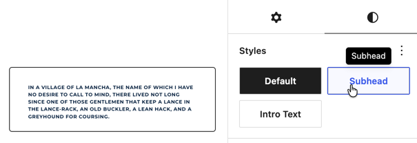
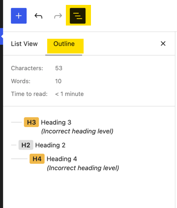
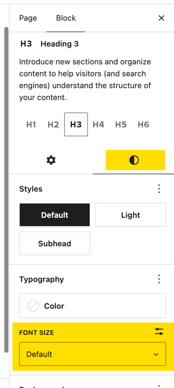

We follow accessibility standards for writing code in the theme and custom plugins. Much of the responsibility is in the editor's hands in building accessible pages.

### Acessibility Resources
Check these resources for a complete guide to writing accessible content. Some key rules to follow are below.

 - [Writing for Web Accessibility fro w3.org](https://www.w3.org/WAI/tips/writing/)
 - [Accessible Writing Techniques for Web Content](https://www.a11y-collective.com/blog/accessible-writing/)

### Alt Text
All images should have alt text. You can add alt text while viewing the file in the [Media Library](/wp-admin/upload.php).

For guidance on alt text refer to [An Alt Decision Tree](https://www.w3.org/WAI/tutorials/images/decision-tree/)

**At a minimum, any image that includes text should include the text in the alt text.**

### Links should have meaningful labels
When someone uses a screen reader, they often navigate by tabbing through links or reviewing a list of all links on a page. If your links just say “click here” or “read more,” users will have no idea where those links lead.

### No All Caps
WHEN YOU WRITE IN ALL CAPS ITS LIKE YOU ARE YELLING at the screenreader.

|                                                              |                                                              |
| ------------------------------------------------------------ | ------------------------------------------------------------ |
|  | **Use Styles instead**  If your website style includes all caps text (as in buttons or subheads). We handle that via css. You will find a style for it in the style tab of the block settings (for paragraphs or headings). |

### Page Layout
In building your pages, headers should convey meaning and structure.

Good headings provide an outline of the content. They should be placed on the page in order to form a proper outline (h2 > h3 > h4). There should be one and only one h1 on a page.

|                                                              |                                                              |
| ------------------------------------------------------------ | ------------------------------------------------------------ |
|  | **Check your work**  You can view your outline in the Outline view within the editor.  This example shows the headings out of order. |
|  |  **Modifying the Font Size**   **Heading levels should not be selected based on appearance.** If a smaller text size is desired you can change the font size in the block settings style tab. |

