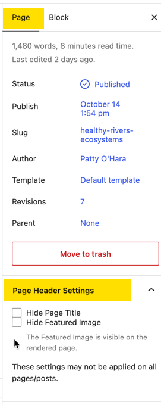
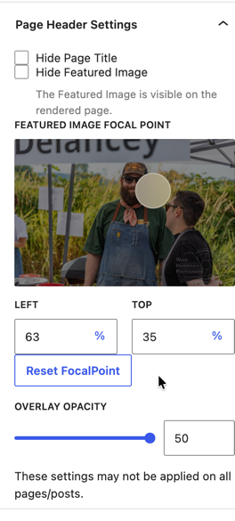

### Page Headers
The page headers are coded into the template for each page type. They usually include the Page Title and Featured Image.

If you need to customize the header for a specific page, as in adding additional text or a slider. You can replace the header with a block.

|                                                              |                                                              |
| ------------------------------------------------------------ | ------------------------------------------------------------ |
|  | **Hide the Page Title or Featured Image**  From the Page Settings Pane find the Page Header Settings tab. You can hide the page title and/or the featured image. |

### Featured Images
Featured Images are usually displayed in the page header if added. They are also used in the roll-up views of content (as on the blog landing page).

For best results featured images should be horizontal layout and 2600px wide. In most views they will be cropped to fit a standard size. You can control the crop to some degree by setting the focal point of the image. You want to avoid cutting off a person's head.

|                                                              |                                                              |
| ------------------------------------------------------------ | ------------------------------------------------------------ |
|  | **Set a Focal Point**  Once the featured image is added you can set the focal point from the page header settings. This focal point will also apply in the roll-up views. |

